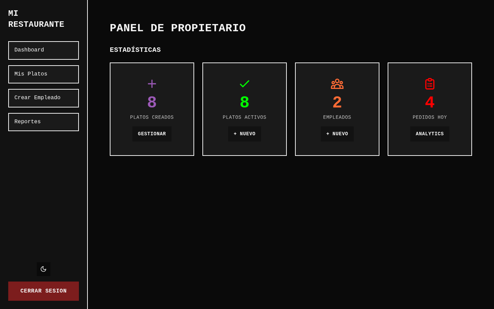
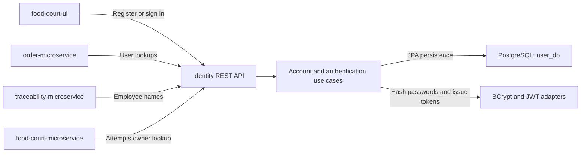

<!-- markdownlint-disable-next-line MD041 -->
<div align="center">

<h1>Food Court — Identity API</h1>

<p><strong>Accounts and role-based sign-in for customers, employees, owners, and administrators.</strong></p>

<p>
<a href="https://github.com/diegnghtmr/user-microservice/actions/workflows/ci.yml"></a>


<a href="LICENSE"></a>
</p>

<p>
<a href="https://diegnghtmr.me/en/work/food-court/"><strong>Case study</strong></a> &bull;
<a href="#quick-start"><strong>Quick start</strong></a> &bull;
<a href="#architecture"><strong>Architecture</strong></a> &bull;
<a href="https://github.com/diegnghtmr/food-court-ui"><strong>Web app</strong></a>
</p>

</div>

<p align="center"></p>

*The Food Court owner workspace uses this API for employee accounts and restaurant staffing.*

A diner and a kitchen employee use the same app but should not get the same access. The Identity API manages their accounts, issues JWTs with the applicable role and restaurant context, and exposes the user lookup endpoints other Food Court services need.

## Features

- **Role-specific account creation.** Separate endpoints create clients, employees, owners, and administrators.
- **Password hashing.** The service stores BCrypt password hashes instead of plaintext passwords.
- **JWT sign-in.** Successful login issues a token carrying the account ID and roles and, when available, the restaurant ID.
- **Restaurant staffing.** The API links employees to a restaurant and lists the employees assigned to it.
- **Identity lookup.** Other services can look up a user by ID or email, check an ID’s existence, or list owner records.

## Quick start

Install JDK 25 and Docker with Compose. Start the PostgreSQL container and run the service on the host with the checked-in Gradle wrapper.

```sh
git clone https://github.com/diegnghtmr/user-microservice.git
cd user-microservice
docker compose up -d user-postgres
./gradlew bootRun
```

API: `http://localhost:8090/user-api`. Open [Swagger UI](http://localhost:8090/user-api/swagger-ui.html) to explore `POST /auth/login` and the routes under `/user`.

The local PostgreSQL port is `5431`. For other connections, see the [database settings](docs/reference.md#data-store-and-environment).

## Architecture

Spring MVC and application handlers hand off to domain use cases. Adapters implement database access, password hashing, and token issuance outside the account rules.



## Tech stack

| Layer | Technology |
| --- | --- |
| HTTP and security | Java 25, Spring Boot 4.0, Spring MVC, Spring Security, BCrypt, JJWT |
| Data and API docs | Spring Data JPA, PostgreSQL, MapStruct, springdoc OpenAPI |
| Build and tests | Gradle 9.2.1, JUnit Platform, H2, JaCoCo |

## Testing

```sh
./gradlew build
```

[CI](.github/workflows/ci.yml) builds and tests on Temurin 25. Use `./gradlew test` for the test task, which also writes JaCoCo HTML and XML reports. The suite includes a Spring context check and domain tests for user creation.

## Documentation

- [Identity API reference](docs/reference.md) — account and login routes, PostgreSQL settings, ports and adapters, and system diagrams.

## Related repositories

| Repository | Role |
| --- | --- |
| [food-court-ui](https://github.com/diegnghtmr/food-court-ui) | Role-aware sign-in and account management screens |
| [food-court-microservice](https://github.com/diegnghtmr/food-court-microservice) | Restaurant and dish catalog, with a client for owner lookup |
| [order-microservice](https://github.com/diegnghtmr/order-microservice) | Uses customer lookups during the order lifecycle |
| [traceability-microservice](https://github.com/diegnghtmr/traceability-microservice) | Resolves employee names for fulfillment reports |

## License

Released under the [MIT License](LICENSE).
